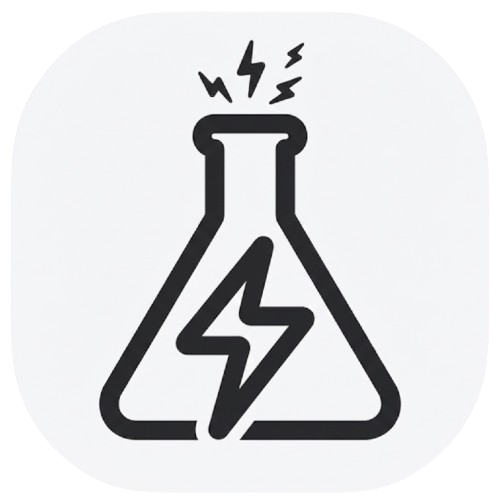

<div align="center">



# YouTube Music Desktop App

**Desarrollado por Nexus Labs Inc. & TheDr!xx**

</div>

Aplicación de escritorio no oficial para YouTube Music, con complementos y opciones de personalización.

> [!IMPORTANT]
> **Aviso legal**
>
> Este proyecto no está afiliado, autorizado, respaldado ni conectado oficialmente con Google LLC, Alphabet Inc., YouTube Music ni ninguna de sus empresas, subsidiarias o afiliadas. Es un proyecto independiente y no oficial.
>
> Los nombres y marcas de Google, YouTube y YouTube Music pertenecen a sus respectivos titulares y se usan únicamente con fines de identificación. El software se ofrece «TAL CUAL», sin garantías; su uso queda bajo responsabilidad de quien lo instala.

## Contenido

- [Traducciones](#traducciones)
- [Temas](#temas)
- [Desarrollo](#desarrollo)
- [Crea tus propios complementos](#crea-tus-propios-complementos)
  - [Crear un complemento](#crear-un-complemento)
  - [Casos de uso comunes](#casos-de-uso-comunes)
- [Compilación](#compilación)
- [Vista previa de producción](#vista-previa-de-producción)
- [Pruebas](#pruebas)
- [Licencia](#licencia)
- [Aviso y créditos](#aviso-y-créditos)

## Traducciones

Puedes colaborar con las traducciones en [Hosted Weblate](https://bit.ly/48n5YF7).

<a href="https://bit.ly/48n5YF7">
  
  
</a>

## Temas

Puedes cargar archivos CSS para cambiar la apariencia de la aplicación (Opciones > Ajustes visuales > Temas).

Hay temas prediseñados disponibles en https://github.com/kerichdev/themes-for-ytmdesktop-player.

## Desarrollo

Con el repositorio clonado y abierto en una terminal:

```bash
pnpm install --frozen-lockfile
pnpm dev
```

También puedes usar [devcontainers](https://containers.dev/) como entorno de desarrollo en VS Code o para compilar el proyecto sin instalar dependencias en tu sistema.

Ten en cuenta que los devcontainers tienen limitaciones; por ejemplo, la interfaz gráfica puede no funcionar en algunos sistemas Linux.

## Crea tus propios complementos

Con los complementos puedes:

- Manipular la aplicación: el controlador del complemento recibe el `BrowserWindow` de Electron.
- Cambiar la interfaz modificando el HTML y el CSS.

### Crear un complemento

Crea una carpeta en `src/plugins/NOMBRE-DE-TU-COMPLEMENTO`:

- `index.ts`: archivo principal del complemento.
```typescript
import style from './style.css?inline'; // import style as inline

import { createPlugin } from '@/utils';

export default createPlugin({
  name: 'Plugin Label',
  restartNeeded: true, // si es true, YouTube Music muestra un diálogo para reiniciar
  config: {
    enabled: false,
  }, // configuración personalizada
  stylesheets: [style], // estilos personalizados
  menu: async ({ getConfig, setConfig }) => {
    // Todos los métodos *Config devuelven Promise<T>
    const config = await getConfig();
    return [
      {
        label: 'menu',
        submenu: [1, 2, 3].map((value) => ({
          label: `value ${value}`,
          type: 'radio',
          checked: config.value === value,
          click() {
            setConfig({ value });
          },
        })),
      },
    ];
  },
  backend: {
    start({ window, ipc }) {
      window.maximize();

      // Puedes comunicarte con el complemento del renderer
      ipc.handle('some-event', () => {
        return 'hello';
      });
    },
    // Se ejecuta cuando cambia la configuración
    onConfigChange(newConfig) { /* ... */ },
    // it fired when plugin disabled
    stop(context) { /* ... */ },
  },
  renderer: {
    async start(context) {
      console.log(await context.ipc.invoke('some-event'));
    },
    // Hook disponible solo en el renderer
    onPlayerApiReady(api, context) {
      // Cambia fácilmente la configuración del complemento
      context.setConfig({ myConfig: api.getVolume() });
    },
    onConfigChange(newConfig) { /* ... */ },
    stop(_context) { /* ... */ },
  },
  preload: {
    async start({ getConfig }) {
      const config = await getConfig();
    },
    onConfigChange(newConfig) {},
    stop(_context) {},
  },
});
```

### Casos de uso comunes

- Inyectar CSS personalizado: crea un archivo `style.css` en la misma carpeta y úsalo así:

```typescript
// index.ts
import style from './style.css?inline'; // importa los estilos como texto

import { createPlugin } from '@/utils';

export default createPlugin({
  name: 'Plugin Label',
  restartNeeded: true, // si es true, la aplicación mostrará un diálogo para reiniciar
  config: {
    enabled: false,
  }, // configuración personalizada
  stylesheets: [style], // estilos personalizados
  renderer() {} // define el hook del renderer
});
```

- Para modificar el HTML:

```typescript
import { createPlugin } from '@/utils';

export default createPlugin({
  name: 'Plugin Label',
  restartNeeded: true, // si es true, YouTube Music mostrará el diálogo para reiniciar
  config: {
    enabled: false,
  }, // configuración personalizada
  renderer() {
    console.log('hola desde renderer');
  } // define el hook del renderer
});
```

- La comunicación entre frontend y backend se puede hacer con el módulo `ipcMain` de Electron. Consulta `index.ts` y el complemento `sponsorblock` como ejemplo.

## Compilación

1. Clona el repositorio.
2. Sigue [esta guía](https://pnpm.io/installation) para instalar `pnpm`.
3. Ejecuta `pnpm install --frozen-lockfile` para instalar las dependencias.
4. Ejecuta el comando de compilación para tu sistema operativo.

- `pnpm dist:win`: Windows.
- `pnpm dist:linux`: Linux (amd64).
- `pnpm dist:linux:deb-arm64`: Linux (arm64 para Debian).
- `pnpm dist:linux:rpm-arm64`: Linux (arm64 para Fedora).
- `pnpm dist:mac`: macOS (amd64).
- `pnpm dist:mac:arm64`: macOS (arm64).

La aplicación se compila para macOS, Linux y Windows con [electron-builder](https://github.com/electron-userland/electron-builder).

### Compilar en un devcontainer

1. Clona el repositorio.
2. Abre la carpeta en VS Code.
3. Cuando se solicite, vuelve a abrir el proyecto en el contenedor.
4. Ejecuta `pnpm build` o el comando de distribución correspondiente.
5. Encuentra los archivos generados en la carpeta `dist`.

El espacio de trabajo está montado en el contenedor, por lo que los archivos compilados también estarán disponibles en el sistema anfitrión.

## Vista previa de producción

```bash
pnpm start
```

## Pruebas

```bash
pnpm test
```

Las pruebas de la aplicación usan [Playwright](https://playwright.dev/).

## Licencia

Las contribuciones originales de Nexus Labs Inc. & TheDr!xx se publican bajo la licencia MIT. El código heredado conserva los avisos de copyright y las condiciones de licencia de sus titulares originales. Consulta el archivo [`license`](license).

## Aviso y créditos

Esta aplicación es una bifurcación de [Pear Desktop](https://github.com/pear-devs/pear-desktop), proyecto originalmente desarrollado por sus mantenedores y colaboradores, incluido th-ch. Agradecemos su trabajo: la base de código y las contribuciones originales siguen sujetas a sus avisos de copyright y a la licencia MIT original.

La identidad, el icono y las contribuciones propias de esta bifurcación corresponden a **Nexus Labs Inc. & TheDr!xx**. Este proyecto no reclama la autoría del código heredado ni sustituye sus créditos o avisos legales.
